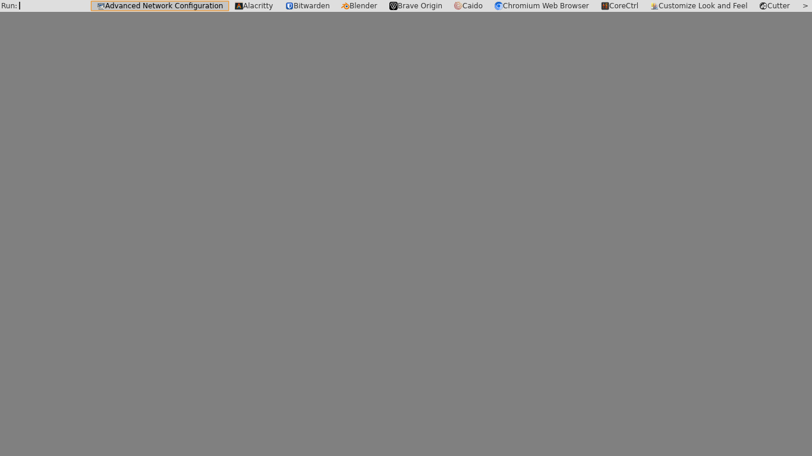

# launcher-rs

`dmenu`-style launcher for X11 window managers: a **horizontal strip** with
**application icons**, incremental search and execution of `.desktop` entries.
It talks to X11 directly and renders in software — no GTK, Qt or other GUI
toolkit.



## Features

- `override-redirect` strip: no borders, gaps or stolen focus.
- Configurable position, width, margins, height and alignment; multi-monitor
  via RandR 1.5 (Xinerama fallback).
- Icons from the XDG Icon Theme spec (PNG and SVG, theme inheritance).
- `prefix`, `substring` or `fuzzy` search, with dmenu/readline editing keys.
- Correct `.desktop` `Exec` handling (quoting, field codes, `Terminal`,
  `Path`), with `setsid` when available.
- `Tab` switches between `.desktop` apps and `$PATH` commands; `--dmenu` mode
  for pipes.
- TOML styling with 14 ready-made themes, radii and borders.
- Single instance per display; ~25 ms to the first frame.

## Installation

Requires Rust stable (1.89+) and an X11 session. All dependencies are pure Rust,
so no X11/XCB or fontconfig development packages are needed.

```bash
git clone https://github.com/EitaPreulaJhol/launcher-rs.git
cd launcher-rs
./install.sh                 # builds and installs into ~/.local/bin
```

Then bind `launcher-rs` to a key in your window manager (bspwm, awesome,
openbox, dwm, …). Some examples are in
[docs/installation.md](docs/installation.md#window-manager-setup).

Other install methods, prebuilt binaries and the status bar note are in
[docs/installation.md](docs/installation.md).

## Documentation

| Document | Contents |
| --- | --- |
| [Installation](docs/installation.md) | Requirements, `install.sh`, `cargo install`, window manager setup |
| [Usage](docs/usage.md) | CLI flags, keybindings, `--dmenu`, `--print`, monitor targets |
| [Configuration](docs/configuration.md) | TOML reference, themes, colors and style options |
| [Architecture](docs/architecture.md) | Modules, data flow, rendering, geometry and design decisions |
| [Development](docs/development.md) | Build, tests, debug tools, contributing and releases |

The commented example config is [`config.example.toml`](config.example.toml).

## License

MIT.
